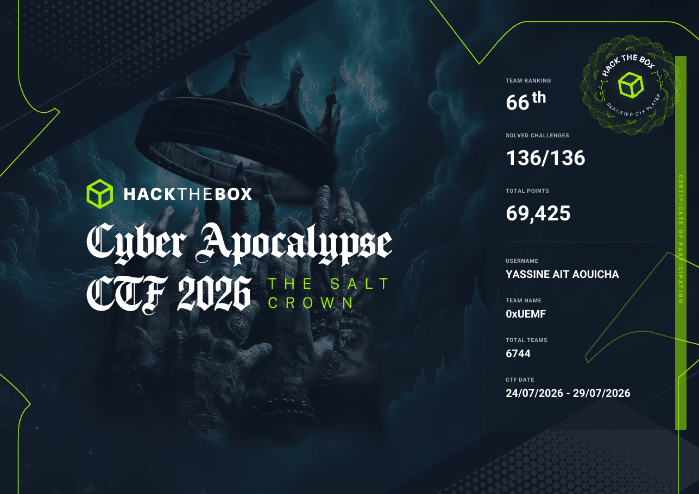
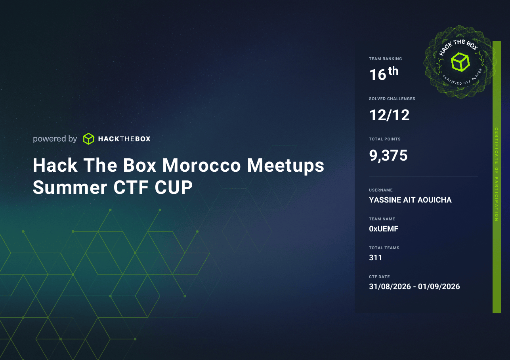
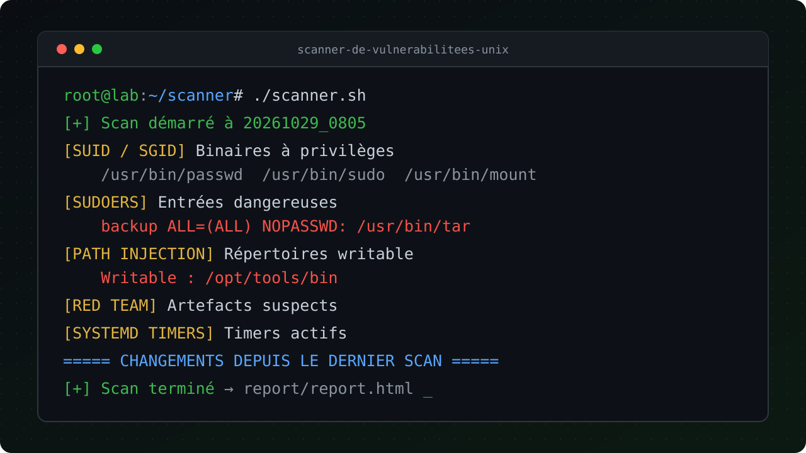

  

  
  

## About Me

- 🎓 IT & Cybersecurity student at EIDIA, Euro-Mediterranean University of Fes
- 📜 BTS graduate in Information Systems Development
- 💻 Backend developer focused on Java and Spring Boot, also working with PHP, Node.js and PostgreSQL
- 🛡️ Interested in pentesting, Linux hardening, networking and cryptography
- 🏁 CTF player with team 0xUEMF: 66th of 6,744 teams at Hack The Box Cyber Apocalypse 2026
- 📫 Reach me on [LinkedIn](https://www.linkedin.com/in/yassine-aitaouicha-a99653389)

 

## Tech Stack

<table>
  <tr>
    <td width="190"><b>Languages</b></td>
    <td>
      
      
      
      
      
      
      
      
      
      
    </td>
  </tr>
  <tr>
    <td><b>☕ My Daily Brew</b></td>
    <td>
      
      
      
      
      
    </td>
  </tr>
  <tr>
    <td><b>Backend &amp; Databases</b></td>
    <td>
      
      
      
      
      
      
      
      
      
      
      
    </td>
  </tr>
  <tr>
    <td><b>Frontend &amp; Mobile</b></td>
    <td>
      
      
      
      
      
    </td>
  </tr>
  <tr>
    <td><b>Machine Learning</b></td>
    <td>
      
      
      
      
    </td>
  </tr>
  <tr>
    <td><b>DevOps &amp; Tools</b></td>
    <td>
      
      
      
      
      
      
      
      
      
    </td>
  </tr>
  <tr>
    <td><b>Security &amp; Networking</b></td>
    <td>
      
      
      
      
      
    </td>
  </tr>
  <tr>
    <td><b>Virtualization &amp; Backup</b></td>
    <td>
      
      
      
    </td>
  </tr>
</table>

## Certifications & CTFs

<table>
  <tr>
    <td width="50%" valign="top">
      
      
<b>HTB Cyber Apocalypse CTF 2026</b> 66th of 6,744 teams · 136/136 challenges

    </td>
    <td width="50%" valign="top">
      
      
<b>HTB Morocco Meetups Summer CTF Cup</b> 16th of 311 teams · 12/12 challenges

    </td>
  </tr>
</table>

**SecDojo CyberLab**, 6 labs completed during the DGSSI competition:

| Lab | Focus | Level | Certificate |
|---|---|---|---|
| OpenClaw | AI security | Advanced | [Verify](https://cyberlab.sec-dojo.com/certificate/15861427-4423-4c90-b29f-cd07a645c450?language_code=en) |
| MCP | AI security, Model Context Protocol | Intermediate | [Verify](https://cyberlab.sec-dojo.com/certificate/e9e2ab19-cb2b-4d26-b8c6-0c14c2fca3ea?language_code=en) |
| Nebula | MCP security, unauthorized access | Intermediate | [Verify](https://cyberlab.sec-dojo.com/certificate/b63c71a4-353e-49af-8b74-f64f85957954?language_code=en) |
| Labyrinth | Active Directory, forensics, Splunk | Basic | [Verify](https://cyberlab.sec-dojo.com/certificate/6a4ce132-b71b-4453-831e-f9f715f160e8?language_code=en) |
| Compete | Web exploitation | Basic | [Verify](https://cyberlab.sec-dojo.com/certificate/0cb60a2c-d47b-4635-9297-c5b22b95dfb7?language_code=en) |
| Teletype | Linux, CVE-2026-24061 | Basic | [Verify](https://cyberlab.sec-dojo.com/certificate/1505afd4-97fa-4481-be0c-8927ba30c83e?language_code=en) |

<a href="certifications/"><b>See all certificates →</b></a>

## Featured Projects

<table>
  <tr>
    <td colspan="2" valign="top">
      
      <h3><a href="https://github.com/creepout777/network-intrusion-detection-ml">SentinelAI: Network Intrusion Detection</a></h3>
      
Captures live traffic, rebuilds NSL-KDD connection features and scores them with an SVM (97% precision on unseen attack types), then groups detections into incidents with attack-family typing, threat hunting and Shodan intel in a SOC-style console.

      
      
      
      
      
      
    </td>
  </tr>
  <tr>
    <td width="50%" valign="top">
      
      <h3><a href="https://github.com/creepout777/Atlas-Charge-Plus">Atlas Charge Plus+</a></h3>
      
Mobile EV charging fleet platform with a multi-role web app, a native Android app and an Android Automotive dashboard.

      
      
      
      
    </td>
    <td width="50%" valign="top">
      
      <h3><a href="https://github.com/creepout777/UEMF-University-Management">UEMF University Management</a></h3>
      
University management system with role-based dashboards, grades, attendance and Telegram notifications, deployed on a VPS.

      
      
      
      
    </td>
  </tr>
  <tr>
    <td width="50%" valign="top">
      
      <h3><a href="https://github.com/creepout777/scanner-de-vulnerabilitees-unix">Unix Vulnerability Scanner</a></h3>
      
Modular Bash scanner that checks SUID/SGID binaries, sudoers rules, PATH injection and persistence artifacts, then generates an HTML report.

      
      
    </td>
    <td width="50%" valign="top">
      
      <h3><a href="https://github.com/creepout777/reseaux-avancees-architecture-reseau-euromed">UEMF Campus Network</a></h3>
      
Three-tier network architecture for a six-building university campus, designed and simulated in Cisco Packet Tracer.

      
      
    </td>
  </tr>
</table>

### More Projects

| Project | Description | Language |
|---|---|---|
| [Phishing Shield](https://github.com/creepout777/phishing-detector-extension-ml) | Chrome extension that blocks phishing pages, Random Forest model (94% accuracy) served by a local FastAPI |   |
| [ML Course Notebooks](https://github.com/creepout777/ml-course-notebooks) | Preprocessing, five regression models and logistic regression, solved and compared |  |
| [Malicious Login Detector](https://github.com/creepout777/malicious-login-detector-Advanced-Algorithmics) | Brute-force and credential-stuffing detection using custom data structures |  |
| [Apache Server Hardening](https://github.com/creepout777/securisation-serveur-apache) | ACLs, SGID, sticky bit, iptables and sudoers on a Linux web server |  |
| [Antivirus Simulator](https://github.com/creepout777/antivirus-simulator) | Signature-based file scanner with quarantine, built on linked lists |  |
| [Distributed Applications](https://github.com/creepout777/TP-applications-distribuees-python) | Client/server, retry with backoff, asyncio and secure JSON/XML/Protobuf parsing |  |
| [ESXi vs Proxmox VE](https://github.com/creepout777/Exploration-et-comparaison-de-VMware_ESXi-et-Proxmox_VE) | Hands-on comparison of two Type-1 hypervisors |  |

## GitHub Stats

  

