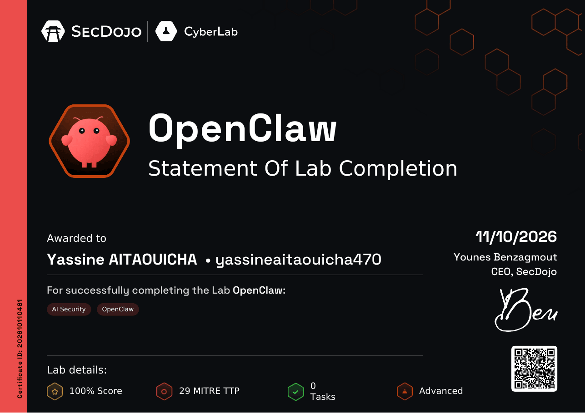
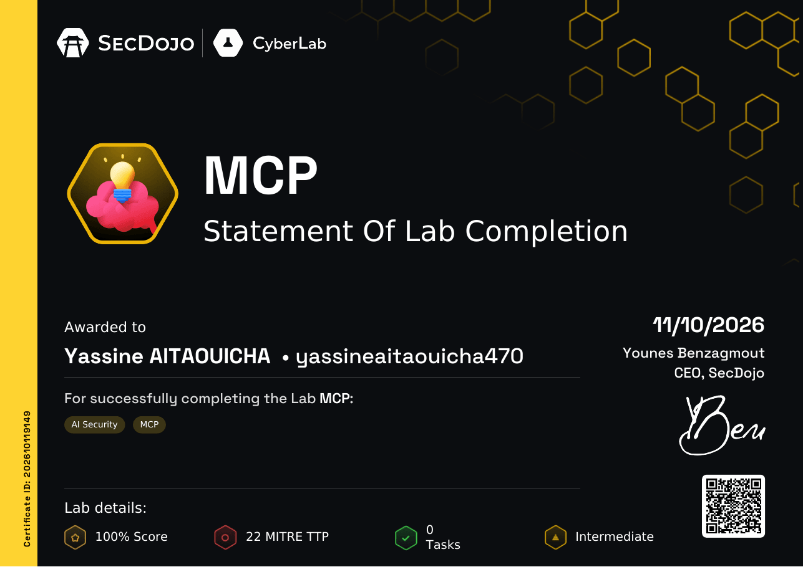
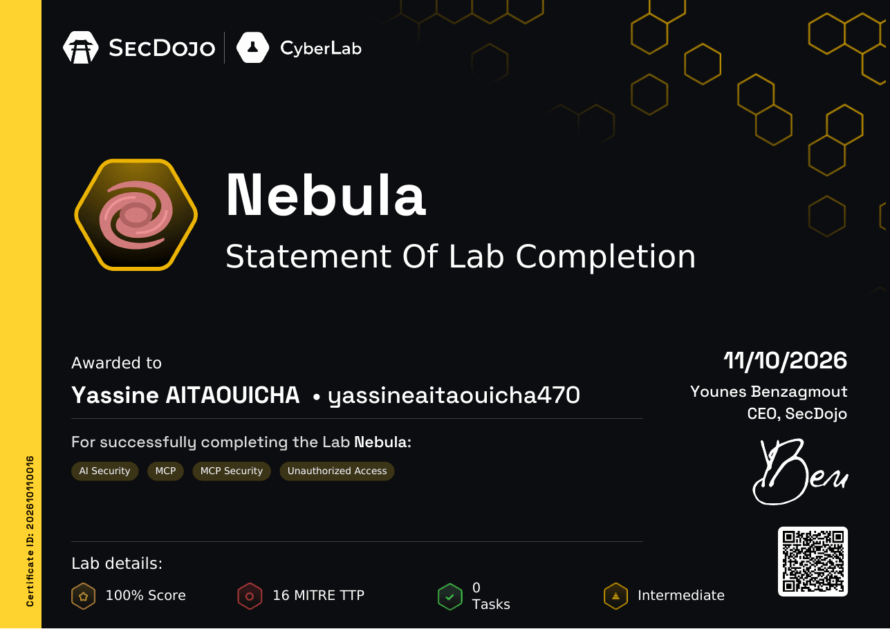
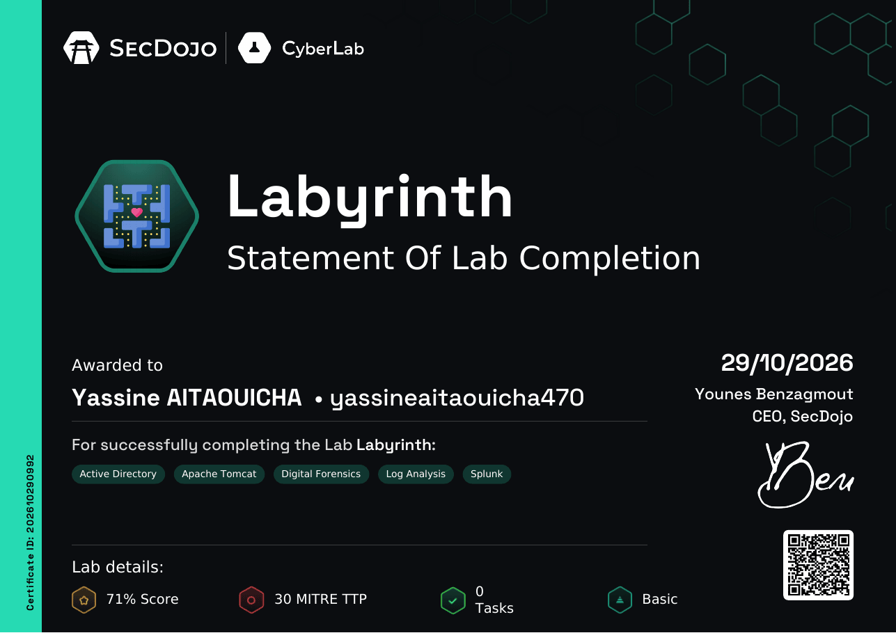
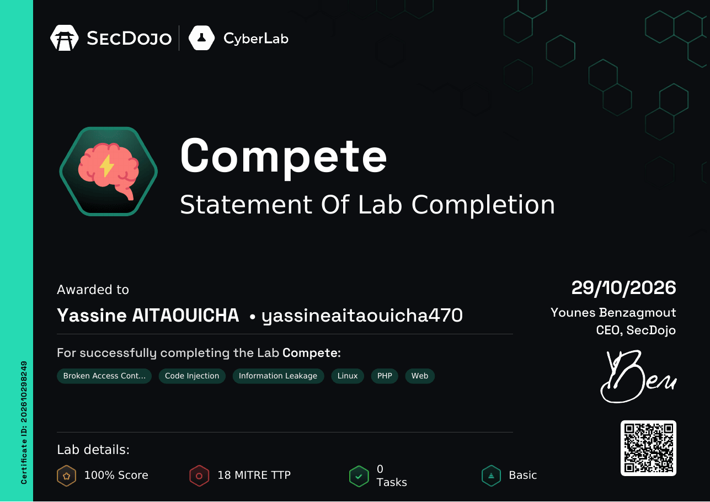
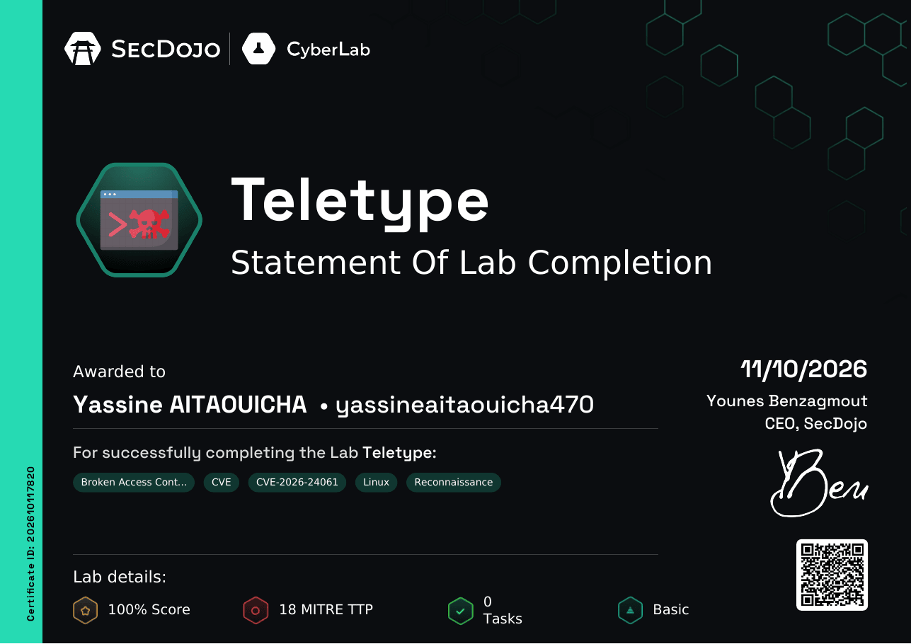

# Certifications & CTFs

Capture-the-flag results and hands-on lab certifications of Yassine Aitaouicha.

[CTF results](#ctf-results) &nbsp;·&nbsp; [Lab certifications](#lab-certifications) &nbsp;·&nbsp; [Back to profile](https://github.com/creepout777)

## CTF results

Competing with team **0xUEMF**.

| Event | Dates | Team rank | Challenges | Points | Certificate |
|---|---|---|---|---|---|
| Hack The Box **Cyber Apocalypse CTF 2026: The Salt Crown** | 24–29 Jul 2026 | **66th** of 6,744 teams | 136 / 136 | 69,425 | [PDF](pdf/htb-cyber-apocalypse-2026.pdf) |
| Hack The Box **Morocco Meetups Summer CTF Cup** | 31 Aug – 1 Sep 2026 | **16th** of 311 teams | 12 / 12 | 9,375 | [PDF](pdf/htb-morocco-summer-ctf-cup-2026.pdf) |

<table>
  <tr>
    <td width="50%"></td>
    <td width="50%"></td>
  </tr>
</table>

## Lab certifications

Statements of lab completion earned during the **DGSSI competition** on SecDojo CyberLab. Each one can be checked on SecDojo's site with the **Verify** link.

| Lab | Focus | Level | Completed | Verify |
|---|---|---|---|---|
| **OpenClaw** | AI security, OpenClaw | Advanced | 11 Oct 2026 | [Verify](https://cyberlab.sec-dojo.com/certificate/15861427-4423-4c90-b29f-cd07a645c450?language_code=en) |
| **MCP** | AI security, Model Context Protocol | Intermediate | 11 Oct 2026 | [Verify](https://cyberlab.sec-dojo.com/certificate/e9e2ab19-cb2b-4d26-b8c6-0c14c2fca3ea?language_code=en) |
| **Nebula** | AI security, MCP security, unauthorized access | Intermediate | 11 Oct 2026 | [Verify](https://cyberlab.sec-dojo.com/certificate/b63c71a4-353e-49af-8b74-f64f85957954?language_code=en) |
| **Labyrinth** | Active Directory, Apache Tomcat, digital forensics, log analysis, Splunk | Basic | 29 Oct 2026 | [Verify](https://cyberlab.sec-dojo.com/certificate/6a4ce132-b71b-4453-831e-f9f715f160e8?language_code=en) |
| **Compete** | Web: broken access control, code injection, information leakage (PHP, Linux) | Basic | 29 Oct 2026 | [Verify](https://cyberlab.sec-dojo.com/certificate/0cb60a2c-d47b-4635-9297-c5b22b95dfb7?language_code=en) |
| **Teletype** | Reconnaissance, broken access control, CVE-2026-24061 (Linux) | Basic | 11 Oct 2026 | [Verify](https://cyberlab.sec-dojo.com/certificate/1505afd4-97fa-4481-be0c-8927ba30c83e?language_code=en) |

<table>
  <tr>
    <td width="50%"></td>
    <td width="50%"></td>
  </tr>
  <tr>
    <td></td>
    <td></td>
  </tr>
  <tr>
    <td></td>
    <td></td>
  </tr>
</table>

The original PDFs are in [`pdf/`](pdf/).

---

Part of <a href="https://github.com/creepout777">Yassine Aitaouicha's profile</a>

